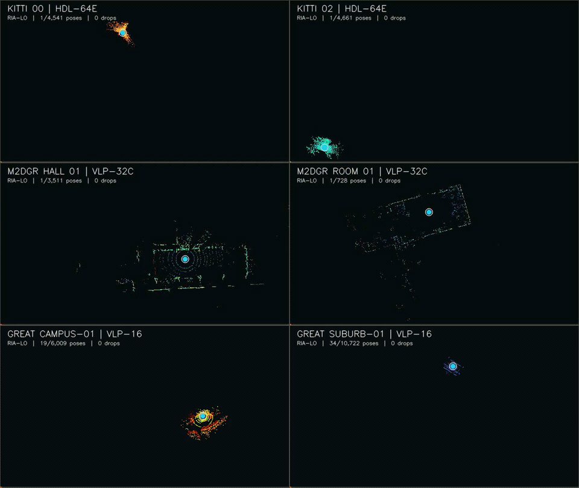
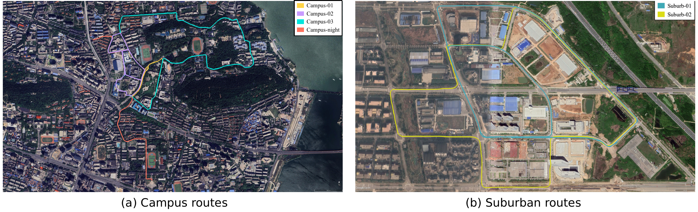
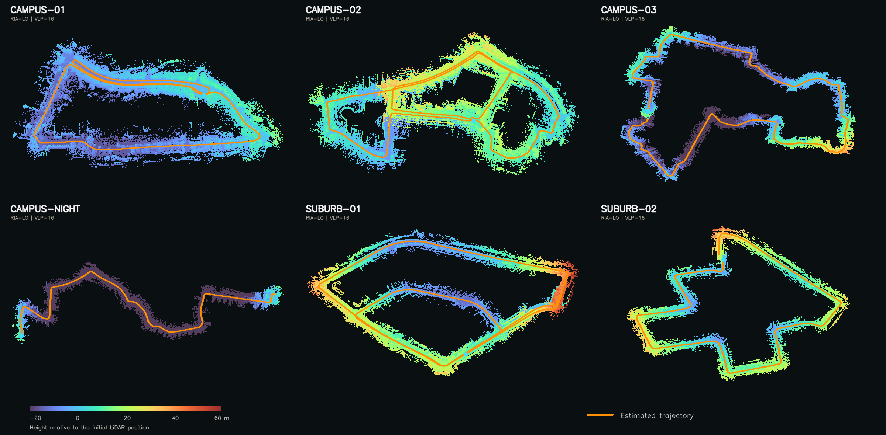

# RIA-LO

**Reliability-aware optimization and exact incremental data association for LiDAR odometry.**

ROS 1 implementation with scan motion compensation, reliability-aware scan-to-map
optimization, and exact incremental correspondence search and geometry reuse.

## Mapping video

Six synchronized views: **KITTI 00/02**, **M2DGR hall_01/room_01**, and
**GREAT campus-01/suburb-01**.

[](https://github.com/qfw23/RIA-LO/raw/refs/heads/main/docs/media/ria_lo_six_sequence_demo.mp4)

[Download the full MP4 (23 s, 1280 × 1080)](https://github.com/qfw23/RIA-LO/raw/refs/heads/main/docs/media/ria_lo_six_sequence_demo.mp4)

## GREAT maps

### Google Earth routes



### Point-cloud renderings



## Results

| Dataset | Sequences | Output poses | Mean translation APE RMSE |
|---|---:|---:|---:|
| KITTI odometry | 00–10 | 23,201 / 23,201 | **3.2988 m** |
| M2DGR indoor | 4 | 11,094 / 11,094 | **0.5028 m** |
| GREAT vehicle | 6 | 50,877 / 50,877 | **15.2936 m** |

APE uses rigid alignment without scale correction; the mean averages sequence
RMSEs. The six GREAT sequences cover **21.823 km** of campus, suburban, and
nighttime driving. KITTI mean internal odometry latency is **21.520 ms**.

### KITTI 00–10

| Sequence | Poses (out/in) | Timed frames | Drops | APE (m) | RPE trans. (m/frame) | RPE rot. (deg/frame) | Mean (ms) | Hz | Max (ms) | Max queue |
|---|---:|---:|---:|---:|---:|---:|---:|---:|---:|---:|
| 00 | 4,541 / 4,541 | 4,540 | 0 | 4.0163 | 0.02686 | 0.12932 | 19.922 | 50.20 | 62.67 | 8 |
| 01 | 1,101 / 1,101 | 1,100 | 0 | 16.7584 | 0.03221 | 0.04968 | 26.747 | 37.39 | 140.02 | 7 |
| 02 | 4,661 / 4,661 | 4,660 | 0 | 5.6752 | 0.02826 | 0.09125 | 19.629 | 50.95 | 145.17 | 9 |
| 03 | 801 / 801 | 800 | 0 | 0.9291 | 0.01767 | 0.06215 | 25.078 | 39.88 | 63.23 | 5 |
| 04 | 271 / 271 | 270 | 0 | 0.2350 | 0.01681 | 0.04499 | 24.985 | 40.02 | 99.02 | 5 |
| 05 | 2,761 / 2,761 | 2,760 | 0 | 2.7697 | 0.01375 | 0.06656 | 20.914 | 47.81 | 65.56 | 6 |
| 06 | 1,101 / 1,101 | 1,100 | 0 | 0.6205 | 0.01405 | 0.03867 | 26.567 | 37.64 | 98.94 | 8 |
| 07 | 1,101 / 1,101 | 1,100 | 0 | 0.4622 | 0.01454 | 0.06461 | 19.110 | 52.33 | 50.30 | 6 |
| 08 | 4,071 / 4,071 | 4,070 | 0 | 2.7329 | 0.03814 | 0.06926 | 23.047 | 43.39 | 80.17 | 8 |
| 09 | 1,591 / 1,591 | 1,590 | 0 | 1.1327 | 0.01718 | 0.06204 | 22.809 | 43.84 | 91.03 | 10 |
| 10 | 1,201 / 1,201 | 1,200 | 0 | 0.9544 | 0.01935 | 0.08540 | 19.050 | 52.49 | 119.02 | 7 |
| **Mean / total** | **23,201 / 23,201** | **23,190** | **0** | **3.2988** | **0.02171** | **0.06945** | **21.520** | **46.47** | **145.17** | **10** |

### M2DGR

Translation APE RMSE (m).

| Method | door_01 | hall_01 | lift_01 | room_01 | Mean |
|---|---:|---:|---:|---:|---:|
| **RIA-LO** | **0.2708** | 0.2580 | 1.3259 | **0.1565** | **0.5028** |
| Fast-GICP | 1.1229 | 0.4908 | 1.4925 | 0.1676 | 0.8185 |
| KISS-ICP | 0.3287 | 0.2677 | 3.1865 | 0.2091 | 0.9980 |
| FasterGICP | 2.4766 | 0.6268 | **0.5452** | 0.3750 | 1.0059 |
| PFilter | 0.2828 | **0.2534** | 4.5604 | 0.1602 | 1.3142 |
| HDL | 5.9065 | 2.8904 | 1.3047 | 1.0633 | 2.7912 |

### GREAT

Translation APE RMSE (m).

| Method | campus-01 | campus-02 | campus-03 | campus-night | suburb-01 | suburb-02 | Mean |
|---|---:|---:|---:|---:|---:|---:|---:|
| **RIA-LO** | **3.964** | 7.485 | **23.977** | 24.168 | 17.452 | **14.717** | **15.294** |
| DLO | 5.916 | **6.088** | 42.504 | **10.771** | **14.939** | 21.677 | 16.982 |
| GenZ-ICP | 6.256 | 13.031 | 29.854 | 28.903 | 21.116 | 17.930 | 19.515 |
| F-LOAM | 10.475 | 17.005 | 67.356 | 34.582 | 27.300 | 24.982 | 30.283 |
| LeGO-LOAM | 5.697 | 7.300 | 47.087 | 21.331 | 85.958 | 16.894 | 30.711 |
| Light-LOAM | 9.991 | 14.659 | 80.049 | 30.183 | 28.679 | 27.315 | 31.813 |
| A-LOAM | 9.832 | 15.276 | 81.066 | 30.322 | 28.624 | 27.698 | 32.136 |
| PFilter | 11.973 | 25.905 | 88.291 | 24.668 | 81.123 | 61.588 | 48.925 |
| KISS-ICP (deskew off) | 18.601 | 21.096 | 115.932 | 102.642 | 38.321 | 32.057 | 54.775 |
| MULLS | 20.008 | 27.458 | 157.521 | 36.738 | 88.723 | 21.502 | 58.659 |
| Fast-GICP (scan-to-scan) | 35.180 | 39.991 | 281.157 | 124.678 | 150.001 | 173.102 | 134.018 |
| FasterGICP (scan-to-scan) | 37.064 | 53.287 | 244.036 | 130.252 | 182.413 | 191.588 | 139.773 |
| HDL Graph SLAM odometry frontend | 63.785 | 137.733 | 393.134 | 226.321 | 341.587 | 416.339 | 263.150 |

## KITTI build and run

### Dependencies

Ubuntu 20.04, ROS Noetic, and a C++14 compiler. With ROS Noetic installed:

```bash
sudo apt update
sudo apt install -y ros-noetic-pcl-conversions ros-noetic-tf \
  libceres-dev libeigen3-dev libpcl-dev
```

### Build

```bash
source /opt/ros/noetic/setup.bash
mkdir -p ~/catkin_ws/src
cd ~/catkin_ws/src
git clone https://github.com/qfw23/RIA-LO.git ria_lo
cd ~/catkin_ws
catkin_make -DCMAKE_BUILD_TYPE=Release -j2
source devel/setup.bash
```

### Run KITTI

Use a KITTI odometry ROS bag containing `sensor_msgs/PointCloud2` scans with
`x`, `y`, `z`, and `intensity` fields on `/velodyne_points`.
The launch file loads [config/kitti.yaml](config/kitti.yaml):
64 scan lines, a 0.1 s scan period, and a 3–90 m range.

**Terminal 1 — start RIA-LO:**

```bash
source /opt/ros/noetic/setup.bash
source ~/catkin_ws/devel/setup.bash
roslaunch ria_lo kitti.launch
```

**Terminal 2 — play the KITTI bag:**

```bash
source /opt/ros/noetic/setup.bash
rosbag play --clock --rate 1.0 /path/to/kitti_00.bag
```

If the bag uses a different LiDAR topic, change `topic` in `config/kitti.yaml`.
Odometry is published on `/odom`, with the `map -> base_link` TF transform.

## Acknowledgments

We thank the authors of **A-LOAM** and **F-LOAM** for their open-source contributions.
